# Free Reels AI

[](CHANGELOG.md)
[]()
[]()
[]()

**Free Reels AI** is an open-source creator studio for turning an idea into a publish-ready YouTube, Instagram, or TikTok Short. Shape a story, choose a visual style and providers, then render a captioned vertical MP4.

Use the web studio, REST API, Docker, or CLI. Run text and voice locally, use stock media, or connect hosted AI providers. The software is free and open source; some third-party image, video, voice, and model services may charge per use.

Maintained by **Haresh** — [GitHub](https://github.com/imharesh) · [Portfolio](https://ai-haresh.vercel.app)

## Demo

Three Shorts made with Free Reels AI. Click a link to play the video.

- ▶️ [**Video 3**](assets/real-data/final-3.mp4)
- ▶️ [**Video 1**](assets/real-data/final-1.mp4)
- ▶️ [**Video 2**](assets/real-data/final-2.mp4)

## Screens

<div align="center">
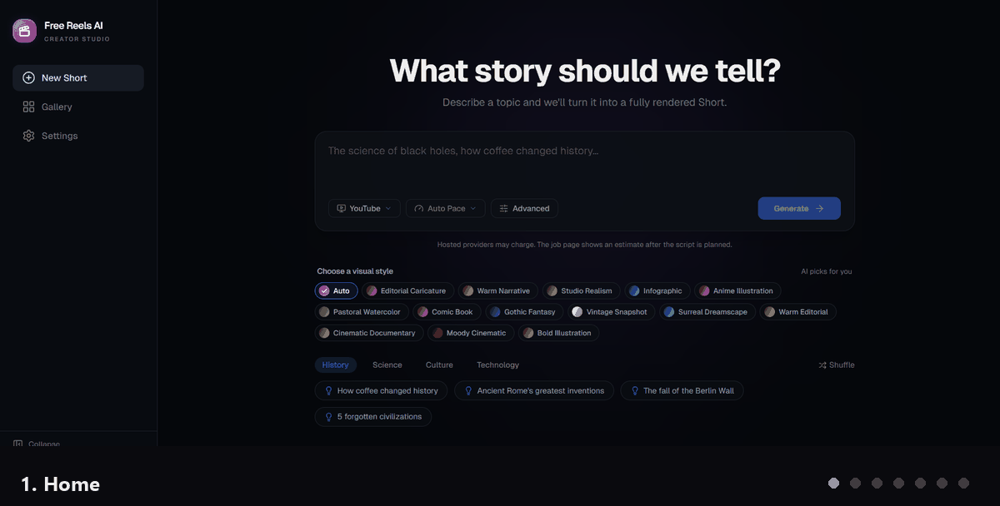

**Home → Gallery → Research → Creative → Voice → Visual → Render**
</div>

<details>
<summary><strong>View each screen full size</strong></summary>

### 1. Home
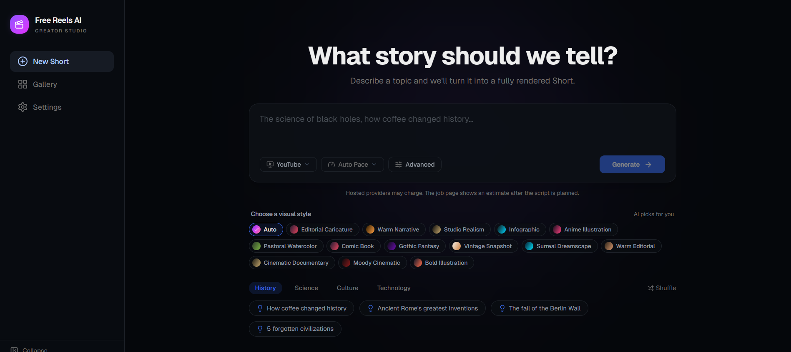

### 2. Gallery
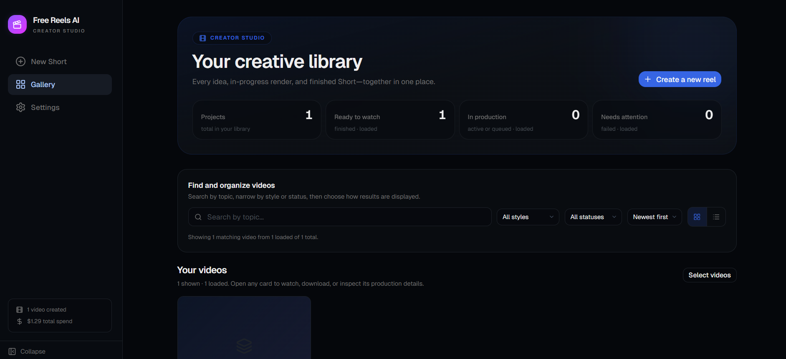

### 3. Research
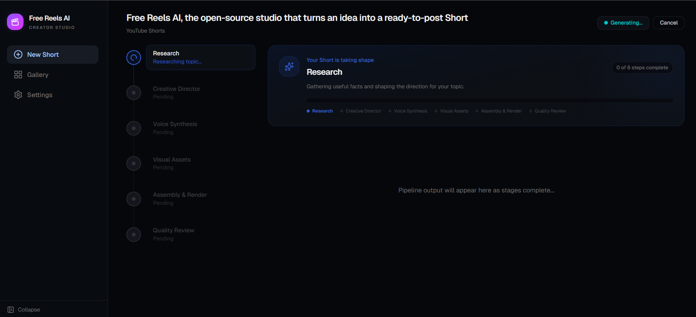

### 4. Creative
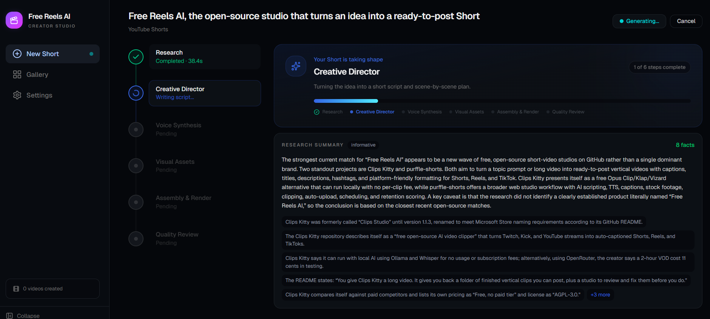

### 5. Voice
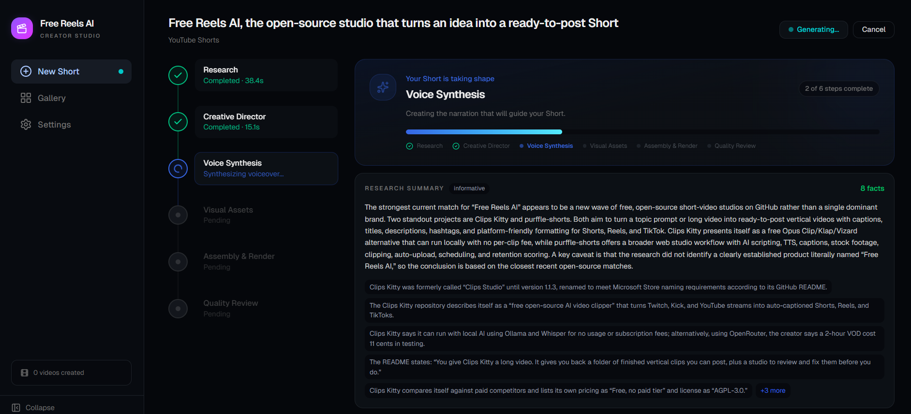

### 6. Visual
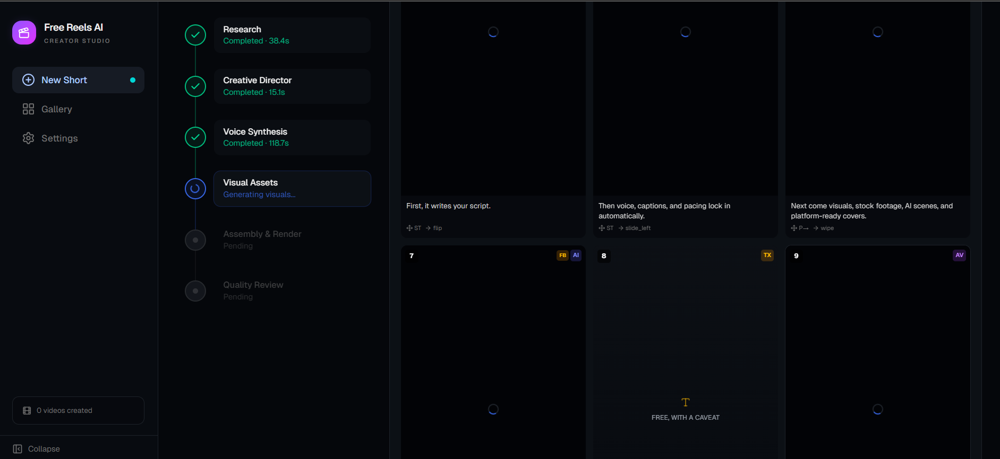

### 7. Render
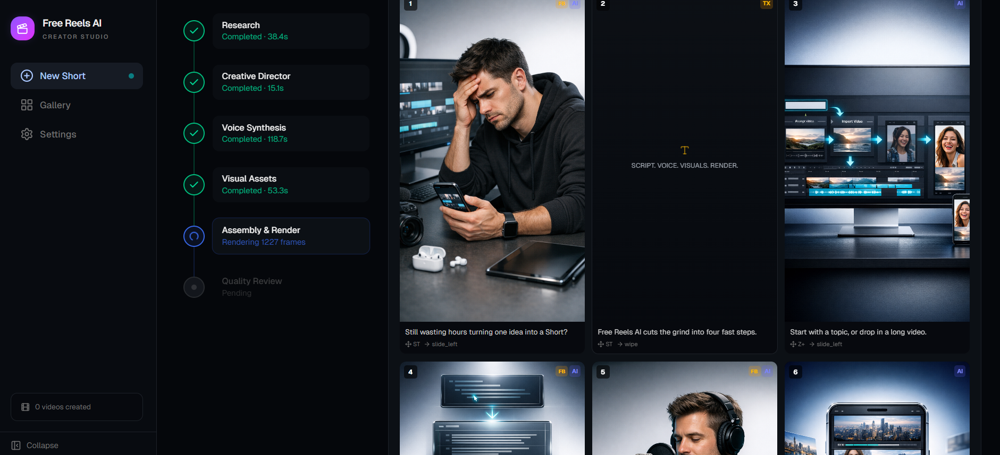

### 8. Ready
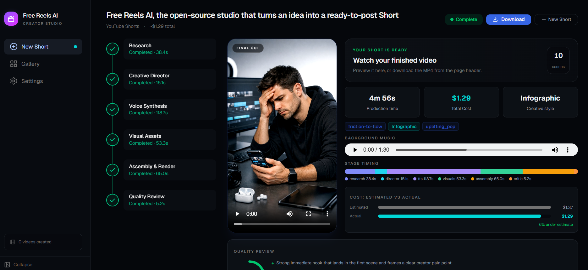

</details>

## How it works

Give it a topic. It handles everything:

| Stage | What happens |
|-------|-------------|
| **Research** | Web search grounds the script in real facts, not hallucinations |
| **Script** | Writes a punchy short-form script with scene breakdowns, visual direction, and emotional arc |
| **Voiceover** | Generates TTS audio with word-level timestamps for karaoke-style captions |
| **Visuals** | AI images (Gemini, DALL-E), AI video clips (Google Veo 3.1, fal.ai Kling 2.6 Pro) with dedicated cinematography prompts and negative prompt guidance, plus vision-verified stock footage that rejects bad matches and retries automatically |
| **Music** | AI-generated background score via Google Lyria 3 Pro, scene-synced to match the video's emotional arc. Or pick from 25 bundled royalty-free tracks |
| **Captions** | Spring-animated 3-state captions with 7 distinct styles, per-archetype theming, and word-level karaoke highlighting |
| **Assembly** | Composites everything into a vertical MP4 via Remotion with crossfade, slide, wipe, and flip transitions |
| **Critique** | AI critic scores the output. If quality is below threshold, the pipeline re-runs |

Every stage streams live progress to the web UI. You watch the AI research, write, paint, compose, and render in real time.

## Provider flexibility

Mix and match providers or go all-in on one ecosystem:

| Capability | Providers |
|-----------|-----------|
| **LLM** | Anthropic Claude, OpenAI GPT, Google Gemini, OpenRouter (300+ models), any OpenAI-compatible endpoint |
| **Search** | Native (provider built-in), Tavily, or parametric knowledge |
| **TTS** | ElevenLabs, Inworld, OpenAI TTS, Gemini TTS, Kokoro (free, local) |
| **Images** | Gemini Imagen, OpenAI DALL-E |
| **Video** | Google Veo 3.1, fal.ai Kling 2.6 Pro (with cross-provider fallback, negative prompts, structured cinematography prompts) |
| **Music** | Google Lyria 3 Pro (AI-generated, $0.08/track), Bundled library (free) |
| **Stock** | Pexels, Pixabay (both searched, vision-verified, with AI fallback) |

**Google workflow:** `--provider google` selects Google models for text, images, voice, video, and music. These API services may incur charges.

**Local text and voice:** Connect Ollama as an OpenAI-compatible LLM and use Kokoro for local text-to-speech. Bundled music is included. AI image/video services are separate; use stock media where it fits to reduce provider charges.

## Cost-conscious setup

For a workflow with no per-request LLM or voiceover API charges:

1. Install [Ollama](https://ollama.com/download) and download a local instruction model, for example:
   ```powershell
   ollama pull gemma4:e2b
   ```
2. In the web app, open **Advanced** and choose **Custom (OpenAI-compatible)**:
   - Model ID: `gemma4:e2b`
   - Base URL: `http://host.docker.internal:11434/v1` when the app runs in Docker Compose on Windows; use `http://localhost:11434/v1` for local development.
   - Search provider: **None** (unless you configure an external search provider).
3. Select **Kokoro (Local)** for voice and **Bundled (Free)** for music.
4. Add a Pexels or Pixabay API key for stock media if you want to use their search.

Ollama runs on your computer and does not need an API key for local inference. Docker Desktop may need Ollama configured to accept connections from containers; only expose Ollama to trusted local/container traffic, and do not publish its port to the internet.

This avoids API usage charges for the local text model and voice, but does **not** make every render free. The current AI image and video integrations use hosted services, and stock footage may not match every scene. Use the cost estimate before confirming a run. Hardware, provider limits, and media licensing terms also apply.

## Quickstart

### Web UI (recommended)

```bash
git clone https://github.com/imharesh/FreeReelAI.git
cd FreeReelAI
cp .env.example .env   # fill in your API keys
docker compose up      # starts Redis + API + Worker
# Open http://localhost:3000
```

Type a topic, choose your style and providers, and watch the pipeline run. Research, script, voiceover, visuals, music, and assembly stages stream live to the browser. Download the final video when it is done.

### Docker CLI (single run)

```bash
cp .env.example .env   # fill in your API keys

docker run --env-file .env --shm-size=2gb -v ./output:/output ghcr.io/imharesh/freereelai "5 stoic lessons that changed my life"
```

Or run through Docker Compose:

```bash
docker compose run worker npx tsx src/index.ts --yes "5 stoic lessons that changed my life"
```

### Local development

**Prerequisites:** Node.js 22+, pnpm, ffprobe

```bash
git clone https://github.com/imharesh/FreeReelAI.git
cd FreeReelAI
pnpm install
cp .env.example .env   # fill in your API keys
```

```bash
# Full pipeline with AI music
pnpm start "the fall of the Roman Empire" --provider google

# Free local TTS, no API spend on voiceover
pnpm start "5 stoic lessons" --provider local

# Dry run (outputs DirectorScore JSON, no asset generation)
pnpm start "your topic" --dry-run

# Specific archetype and provider combo
pnpm start "your topic" --archetype anime_illustration --provider openai

# Creative direction file (guide the AI with a brief)
pnpm start "deep sea exploration" --direction examples/direction-brief.md

# Replay from a previous score (skip research + director, re-render)
pnpm start "your topic" --score output/2026-04-10-111939-.../score.json
```

### API keys

**Hosted services** need their provider key. Local Ollama and Kokoro do not:
- **LLM:** `ANTHROPIC_API_KEY`, `OPENAI_API_KEY`, or `GOOGLE_API_KEY`; alternatively configure Ollama as an OpenAI-compatible endpoint (no local API key).
- **Voice:** `ELEVENLABS_API_KEY` or `INWORLD_TTS_API_KEY`; alternatively choose `--tts-provider kokoro` for local voice.
- `GOOGLE_API_KEY` is also needed for Gemini image generation, AI video (Veo), AI music (Lyria), and Gemini TTS.

**Optional:** `PEXELS_API_KEY` ([Pexels](https://www.pexels.com/api/)), `PIXABAY_API_KEY` ([Pixabay](https://pixabay.com/api/docs/)) for stock footage, `FAL_API_KEY` ([fal.ai](https://fal.ai/)) for Kling video generation

The app does not currently include local image or video generation. If you do not configure an image provider key, stock searches may be used where the selected scenes and available results allow, but AI-image scenes can fail or lack visuals. Provider usage, rate limits, and media license terms still apply.

### Ollama with the CLI

After installing Ollama and pulling a local model, run the text/voice/music stages without hosted LLM, TTS, or music calls:

```powershell
ollama pull gemma4:e2b
pnpm start "how coffee changed history" `
  --provider openai-compatible `
  --llm-base-url http://localhost:11434/v1 `
  --llm-model gemma4:e2b `
  --search-provider none `
  --tts-provider kokoro `
  --music-provider bundled
```

This does not make AI image or video generation local. For the web UI with Docker Compose, use `http://host.docker.internal:11434/v1` as the custom LLM Base URL. Review the per-run estimate before confirming.

### CLI flags

| Flag | Description | Default |
|------|-------------|---------|
| `--provider <name>` | LLM provider (`anthropic`, `openai`, `gemini`, `openrouter`, `openai-compatible`, `google`, `local`) | `anthropic` |
| `--llm-model <model>` | Model ID override (e.g. `anthropic/claude-sonnet-4` for OpenRouter) | provider default |
| `--llm-base-url <url>` | Base URL for `openai-compatible` (e.g. `http://localhost:11434/v1`) | — |
| `--search-provider <name>` | Search provider (`native`, `tavily`, `none`) | auto-detect |
| `--image-provider <name>` | Image provider (`gemini`, `openai`) | `gemini` |
| `--tts-provider <name>` | TTS provider (`elevenlabs`, `inworld`, `kokoro`, `gemini-tts`, `openai-tts`) | `elevenlabs` |
| `--music-provider <name>` | Music provider (`bundled`, `lyria`) | `bundled` |
| `--video-provider <name>` | Video provider (`gemini`, `fal`) | auto-detect |
| `--archetype <name>` | Override visual archetype | LLM chooses |
| `--platform <name>` | Target platform (`youtube`, `tiktok`, `instagram`) | `youtube` |
| `--dry-run` | Output DirectorScore JSON without generating assets | off |
| `--preview` | Open Remotion Studio after rendering | off |
| `-o, --output <dir>` | Output directory | `./output` |
| `--no-music` | Disable background music | music on |
| `--no-video` | Disable AI video generation | video on |
| `--no-stock-verify` | Disable VLM stock footage verification | verify on |
| `--stock-confidence <n>` | Min confidence for stock verification (0-1) | `0.6` |
| `--stock-max-attempts <n>` | Max stock API calls per scene | `4` |
| `--video-model <model>` | Video model override | provider default |
| `--kokoro-voice <voice>` | Kokoro voice preset | `af_heart` |
| `--direction <file>` | Creative brief file (markdown) to guide the AI | — |
| `--score <path>` | Replay from a saved `score.json`, skipping research + director | — |
| `-y, --yes` | Auto-confirm cost estimation (Docker/CI) | off |

## Cost transparency

Before spending any money, the pipeline shows a detailed cost breakdown and asks for confirmation:

```
Estimated cost: $0.686
  LLM:    $0.0029 (7 calls)
  TTS:    $0.0171 (853 chars)
  Images: $0.3030 (3 AI images @ $0.101/ea)
  Video:  $0.3000 (1 AI videos)
  Music:  $0.0802 (Lyria AI generation)
  Stock:  free
```

After rendering, actual cost is computed from real token usage. Use `--dry-run` to preview the DirectorScore without spending anything.

## Archetypes

14 visual styles that control colors, captions, motion, lighting, and AI image prompting. Same topic, four different archetypes:

<div align="center">
<table>
<tr>
<td>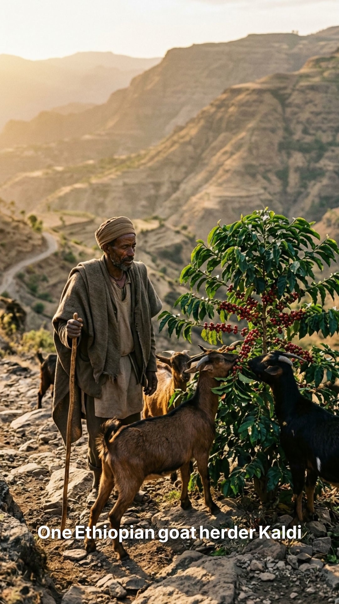</td>
<td>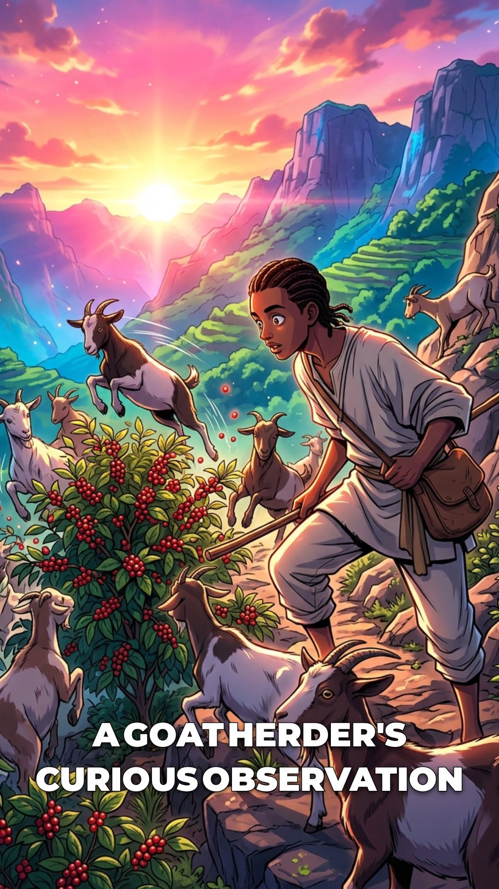</td>
<td>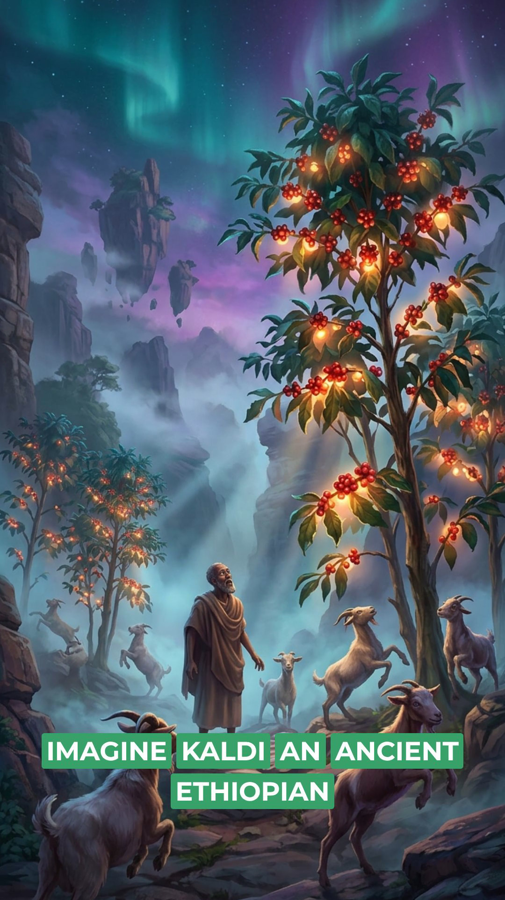</td>
<td>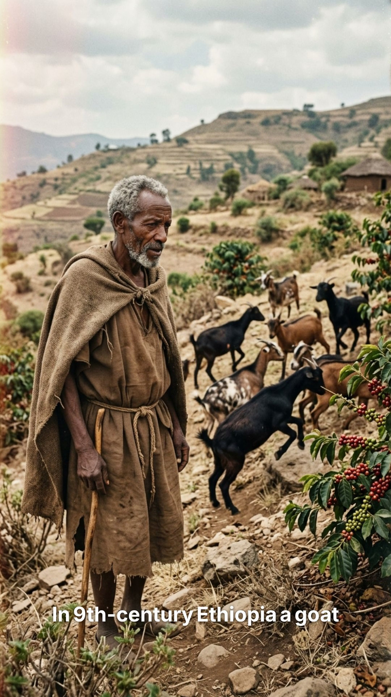</td>
</tr>
<tr>
<td align="center"><em>Cinematic Documentary</em></td>
<td align="center"><em>Anime Illustration</em></td>
<td align="center"><em>Surreal Dreamscape</em></td>
<td align="center"><em>Vintage Snapshot</em></td>
</tr>
</table>
</div>

| Archetype | Best for |
|-----------|----------|
| `editorial_caricature` | News commentary, satire, social issues |
| `warm_narrative` | Storytelling, history, human interest |
| `studio_realism` | Professional photography, editorial, luxury |
| `infographic` | Data, facts, explainers, rapid-fire content |
| `anime_illustration` | Dynamic, action-oriented, pop culture |
| `pastoral_watercolor` | Nature, contemplative, hand-painted aesthetic |
| `comic_book` | Action, adventure, energetic content |
| `gothic_fantasy` | Dark themes, mythology, epic content |
| `vintage_snapshot` | Nostalgic, intimate, personal stories |
| `surreal_dreamscape` | Sci-fi, fantasy, mind-bending topics |
| `warm_editorial` | Lifestyle, people stories, general purpose |
| `cinematic_documentary` | Factual, historical, science |
| `moody_cinematic` | Mystery, tension, crime, dark history |
| `bold_illustration` | Educational, how-to, listicles |

## Author 

- X: [@ai_haresh](https://x.com/ai_haresh)
- Portfolio: [ai-haresh.vercel.app](https://ai-haresh.vercel.app)
